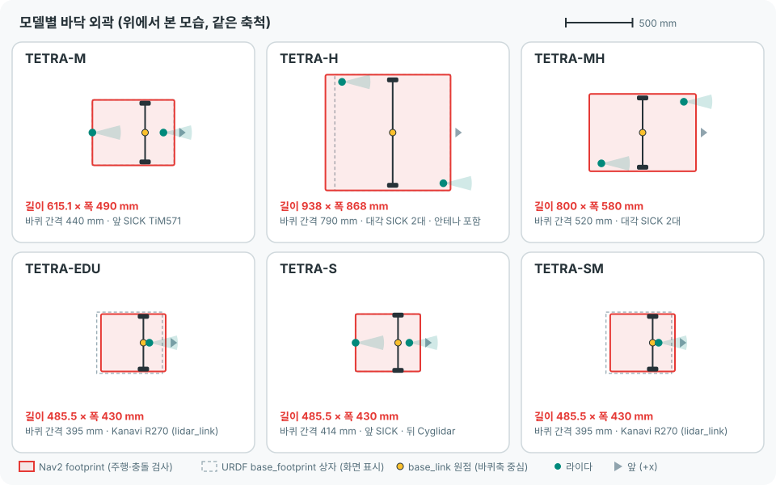
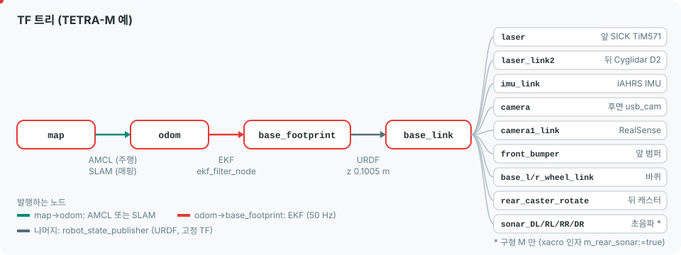

<div align="center">
  
  <h1>tetra_description</h1>
  <p><b>TETRA 로봇 6종의 URDF(xacro) · 3D 메쉬 · TF 프레임</b></p>
  
  
  
</div>

> 이 레포는 [tetra_integration](https://github.com/TETRA-ROBOT/tetra_integration) 의 서브모듈입니다 (`ros/src/tetra_description`). 로봇 실행 방법은 상위 레포와 [tetra_config](https://github.com/TETRA-ROBOT/tetra_config) README 를 보세요.

## 한눈에 보기

- 로봇의 몸체 모양, 바퀴, 라이다·카메라·IMU 가 **어디에 붙어 있는지**(TF 프레임)를 모델별 xacro 로 적어 둔 패키지입니다.
- 실 로봇에서는 `tetra_config` 의 브링업이 모델 폴더의 `tetra.xacro` 를 읽어 `robot_state_publisher` 로 TF 를 냅니다. 이 레포의 런치는 화면에서 모델을 볼 때만 씁니다.
- 프레임 이름을 바꾸면 Nav2·SLAM 파라미터, 센서 드라이버 `frame_id`, 웹 관제 화면이 모두 영향을 받습니다. 위치(숫자)만 고치는 것이 안전합니다.
- 단위는 URDF 표준(m, rad), 좌표는 x 앞 · y 왼쪽 · z 위입니다.

<p align="center"></p>

## 🚀 빠른 시작

로봇 없이 개발 PC 에서 모델을 RViz 로 봅니다. **로봇 스택이 돌고 있는 PC 에서는 하지 마세요** (`robot_state_publisher` 가 둘이 되어 TF 가 섞입니다).

1. 모델을 고르고 URDF 를 발행합니다 (`m` `h` `edu` `mh` `s` `sm`).
   ```bash
   ros2 launch tetra_description tetra_description.launch.py robot_model:=h use_sim_time:=false
   ```
2. 바퀴 관절 값을 냅니다. M 은 바퀴·캐스터가 회전 관절이라 이것이 없으면 RViz 에 "No transform" 이 뜹니다 (다른 모델은 고정 관절이라 없어도 됩니다).
   ```bash
   ros2 run joint_state_publisher joint_state_publisher
   ```
3. RViz 를 엽니다 (Fixed Frame `base_footprint`).
   ```bash
   rviz2 -d $(ros2 pkg prefix tetra_description)/share/tetra_description/rviz/rviz_basic_settings.rviz
   ```

`tetra_description.launch.py` 의 `use_sim_time` 기본값은 `true` 입니다. `/clock` 이 없는 PC 에서는 위처럼 `false` 를 주세요.

## 📦 구성

| 모델 | 읽는 xacro | 브링업 (`tetra_config`) | 비고 |
|---|---|---|---|
| **M** | `urdf/tetra.xacro` (+ 공용 `urdf/base.urdf.xacro`) | `tetra_bringup_m`, `tetra_3d_bringup` | 뒤 초음파 프레임은 `m_rear_sonar:=true` 일 때만 |
| **H** | `urdf/tetraDS/tetra.xacro` | `tetra_bringup_h` | 대각 SICK 2대 (`laser`, `laser_link2`, `laser_merge`) |
| **EDU** | `urdf/tetra_edu/tetra.xacro` | `tetra_bringup_edu` | Kanavi R270 `lidar_link` |
| **MH** | `urdf/tetra_mh/tetra.xacro` | `tetra_bringup_mh`, `tetra_3d_bringup_mh` | 리프트·팬틸트(`herkulex_description`), Autonics 카메라 |
| **MH + RB10** | `urdf/tetra_mh/tetra_rb10.xacro` | `tetra_bringup_mh use_rb10:=true` | 팔은 `rbpodo_description`(이 레포 밖) |
| **S** | `urdf/tetra_s/tetra.xacro` | `tetra_bringup_s`, `tetra_3d_bringup_s` | `livox_frame` (MID-360) |
| **SM** | `urdf/tetra_sm/tetra.xacro` | `tetra_bringup_sm`, `tetra_3d_bringup_sm` | Kanavi R270 `lidar_link` |

| 폴더·파일 | 내용 |
|---|---|
| `tetra_description/urdf/tetra_robot.urdf.xacro` | `robot_model` 인자로 위 모델 하나를 include. `tetra_description.launch.py` 와 Gazebo 시뮬레이션(`tetra_lab` `tetra_gazebo.xacro`)이 씀 |
| `tetra_description/urdf/<모델>/base.urdf.xacro` | 몸체·바퀴·캐스터. **모델마다 자기 폴더의 것을 읽습니다** (공용 `urdf/base.urdf.xacro` 는 M 몸체) |
| `tetra_description/meshes/` | STL 메쉬 (M 앞 라이다 `sick_tim_5xx.stl` 은 sick_scan_xd, Apache-2.0: [NOTICE](tetra_description/meshes/sick_tim_5xx.NOTICE.md)) |
| `tetra_description/launch/` | `tetra_description.launch.py` (`robot_model`), `tetra_{m,h,mh,s,sm}_description.launch.py` (모델 고정) |
| `tetra_description/urdf/legacy_archive/` | 예전 모델 참고용. 어디서도 읽지 않음 |
| `herkulex_description/` | Herkulex 팬틸트·로봇팔 xacro 와 보기용 런치 (`herkulex_pantilt_description.launch.py` 등, RViz 포함) |

## 📐 모델별 치수

URDF(xacro 전개 결과)와 Nav2 footprint(`tetra_config` `params/navigation_<모델>.yaml`)에서 읽은 값입니다. 위 그림이 같은 값을 같은 축척으로 그린 것입니다.

| 모델 | Nav2 footprint 길이 × 폭 | URDF `base_footprint` 상자 | 바퀴 간격 | `base_joint` 높이 |
|---|---|---|---|---|
| M | 615 × 490 mm | 612.7 × 490.4 mm | 440 mm | 0.1005 m |
| H | 938 × 868 mm (뒤 안테나 7 cm 포함) | 868 × 868 mm | 790 mm | 0.1 m |
| EDU | 485.5 × 430 mm | 492 × 460 mm | 395 mm | 0.1 m |
| MH | 800 × 580 mm | (상자 없음) | 520 mm | 0.085 m |
| S | 485.5 × 430 mm | 485.5 × 430 mm | 414 mm | 0.1 m |
| SM | 485.5 × 430 mm | 492 × 460 mm | 395 mm | 0.1 m |

- 주행·충돌 검사는 Nav2 footprint 를 씁니다. URDF 상자는 화면 표시용이라 다를 수 있습니다.
- 웹 관제 지도에 그리는 로봇 외곽도 Nav2 global_costmap footprint 를 읽습니다.

<details>
<summary><b>모델별 주요 센서 프레임 (base_link 기준 x, y, z m · yaw)</b></summary>

| 프레임 | M | H | EDU | MH | S | SM |
|---|---|---|---|---|---|---|
| `laser` (앞 라이다) | 0.137, 0, 0.142 | 0.380, -0.380, 0.152 · -45° | - | 0.309, 0.231, 0.182 · 45° | 0.085, 0, 0.251 | 0.060, 0, 0.210 |
| `laser_link2` (뒤 라이다) | -0.396, 0, 0.211 · 180° | -0.380, 0.380, 0.152 · 135° | - | -0.309, -0.231, 0.182 · -135° | -0.318, 0, 0.255 · 180° | -0.350, 0, 0.244 · 180° |
| `laser_merge` (합친 스캔) | - | 0, 0, 0.152 | - | 0, 0, 0.182 | - | - |
| `lidar_link` (Kanavi R270) | - | - | 0.045, 0, 0.17 · -90° | - | - | 0.045, 0, 0.17 · -90° |
| `imu_link` | 0, 0, 0.2 | 0, 0, 0.126 | - | 0, 0, 0.12 | 0, 0, 0.232 | -0.025, 0, 0.232 |
| `camera1_link` (RealSense) | 0.175, 0, 0 | 0.397, 0, 0.095 | 0.109, 0.03, 0.125 | 0.366, 0.02, 0.118 | 0.135, 0, 0.134 | 0.110, 0.0175, 0.134 |
| `livox_frame` (MID-360) | - | - | - | -0.0915, 0, 0.404 ※ | -0.0915, 0, 0.404 | -0.0915, 0, 0.404 ※ |

※ 실측값이 없어 S 와 같은 자리에 두었습니다.
`m_rear_sonar:=true` 일 때 M 에는 `sonar_DL`, `sonar_RL`, `sonar_RR`, `sonar_DR` 가 붙습니다. MH 의 Autonics 카메라는 `camera_link` (팬틸트 또는 팔 끝) 입니다.
</details>

## 🧭 자주 하는 작업

| 하고 싶은 일 | 방법 |
|---|---|
| 모델 URDF 를 파일로 뽑아 보기 | `xacro $(ros2 pkg prefix tetra_description)/share/tetra_description/urdf/tetra_s/tetra.xacro > /tmp/tetra_s.urdf` |
| M 초음파 프레임까지 보기 | `xacro …/urdf/tetra.xacro m_rear_sonar:=true` |
| 실 로봇에서 센서 위치 확인 (읽기만) | `ros2 run tf2_ros tf2_echo base_link laser` |
| 센서 장착 위치 고치기 | 해당 모델 폴더의 joint `origin` 만 고친 뒤 브링업 재시작. 이름은 그대로 둡니다 |
| 팬틸트·팔만 보기 | `ros2 launch herkulex_description herkulex_pantilt_description.launch.py` |

### xacro 인자

| 인자 | 파일 | 기본값 | 설명 |
|---|---|---|---|
| `robot_model` | `tetra_robot.urdf.xacro` | `m` | `m`, `h`(`ds`, `tetraDS` 도 됨), `edu`, `mh`, `s`, `sm` |
| `m_rear_sonar` | `tetra.xacro` (M) | `false` | 구형 M 뒤 초음파 프레임. M 브링업은 `use_ultrasonic` 값을 넘김 |
| `autonics_camera_mount` | `tetra_mh/tetra_rb10.xacro`, `herkulex_description/urdf/test.xacro` | `gripper` (rb10) · `pantilt` (팔 없음) | Autonics 카메라 자리: `gripper` \| `pantilt` \| `none` |
| `autonics_gripper_xyz` / `_rpy` | `tetra_mh/tetra_rb10.xacro` | `-0.0091 -0.0287 -0.1733` / `3.1416 0 -1.5708` | 팔 끝단 원(`tcp`) 기준 카메라 메쉬 원점·자세 |
| `model_id` | `tetra_mh/tetra_rb10.xacro` | `rb10_1300e` | RB10 모델 |

<details>
<summary><b>실측으로 맞춘 값 (커밋 기록)</b></summary>

| 날짜 | 모델 | 내용 | 커밋 |
|---|---|---|---|
| 2026-10-29 | EDU | RealSense `camera1_link` pitch 0.019 rad (깊이 바닥면 실측) | 6fcbcf6 |
| 2026-10-29 | SM | `camera1_link` y 0.0175 m (깊이 원점이 본체 중심에서 왼쪽). y 0 이면 도킹이 태그 중심보다 1.75 cm 옆으로 맞춰졌음 | aea466f |
| 2026-11-05 | H | 라이다 x·y 0.38013 m, 카메라 중앙 (현장 H 로봇 값. 통합 때 들어온 0.35035 m 로는 앞뒤 스캔이 어긋남) | a65be6c |
| 2026-11-24 | MH | Autonics 카메라 중심이 팔 끝단 원 중심에서 위쪽 17.5 cm, 앞 축으로 180° 뒤집힘 | 80e6ad2, 8a09552 |

</details>

## 🛠 문제 해결

<details>
<summary>RViz 에서 바퀴에 "No transform from [base_l_wheel_link]"</summary>

M 의 바퀴·캐스터는 continuous 관절이라 관절 값이 있어야 TF 가 나옵니다 (H·EDU·MH·S·SM 은 fixed). `joint_state_publisher` 를 함께 띄우세요 (실 로봇 브링업은 `bringup_common.joint_state_publisher_node` 가 0 으로 냅니다).
</details>

<details>
<summary>H·EDU·SM 메쉬와 바퀴 프레임 높이가 실제와 조금 다름</summary>

`base_joint` 는 0.1 m 인데 바퀴 반지름이 H 0.085, EDU·SM 0.075 m 입니다. 센서 높이(TF)를 바꾸지 않으려고 메쉬만 `floor_drop`(H 0.015, EDU·SM 0.025 m)만큼 내렸습니다. 그래서 `base_link`·바퀴 프레임은 실제 바퀴축보다 그만큼 높습니다.
센서 높이를 바닥에서 실측하면 `base_joint` 를 바퀴 반지름으로, `floor_drop` 을 0 으로, 센서 joint z 를 실측값으로 함께 고칩니다.
</details>

<details>
<summary>S·SM 화면에 M 몸체가 보임 / 센서 위치가 M 값</summary>

예전(2026-08 통합 뒤)에는 S·SM 이 공용 `urdf/base.urdf.xacro`(M)를 읽었고, 일부 브링업이 xacro 폴더 없이 M URDF 를 냈습니다. 지금은 모델 폴더의 base 를 읽고 브링업이 `xacro_folder='tetra_s'|'tetra_sm'` 을 줍니다. 오래된 install 이면 다시 빌드하세요.
</details>

<details>
<summary>MH + RB10 xacro 가 <code>rbpodo_description</code> 을 못 찾음</summary>

팔 패키지는 이 레포 밖입니다. 상위 레포 robot.env 의 `TETRA_EXTRA_ROS_SETUP` 으로 그 워크스페이스를 불러온 셸에서 실행하세요.
</details>

## 📚 더 보기

- [CONTEXT.md](CONTEXT.md): 프레임 이름을 쓰는 곳, 모델별 base, `floor_drop`, MH 로봇팔 장착 규칙
- [tetra_description/README.md](tetra_description/README.md): 패키지 예전 설명
- 브링업이 xacro 를 읽는 곳: `tetra_config` `tetra_bringup/launch/bringup_common.py` (`robot_state_publisher_node`)

## 라이선스

Apache-2.0. [LICENSE](LICENSE) 를 보세요. 외부 메쉬는 각 NOTICE 파일을 따릅니다.
